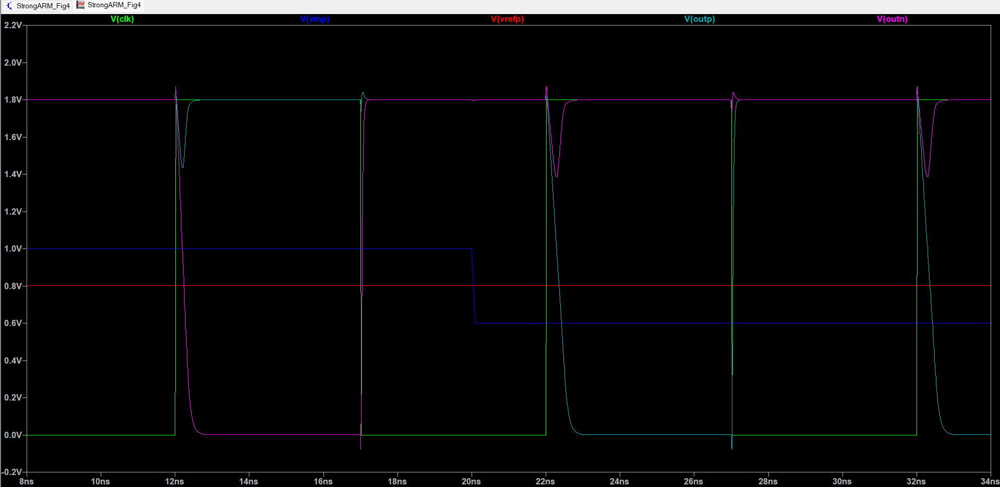
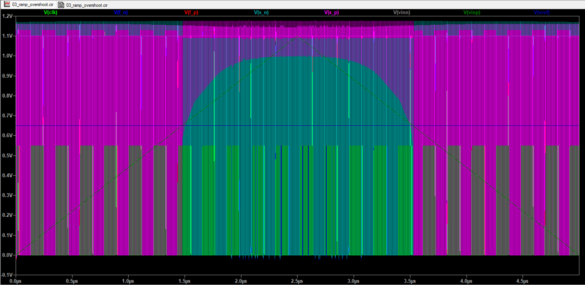
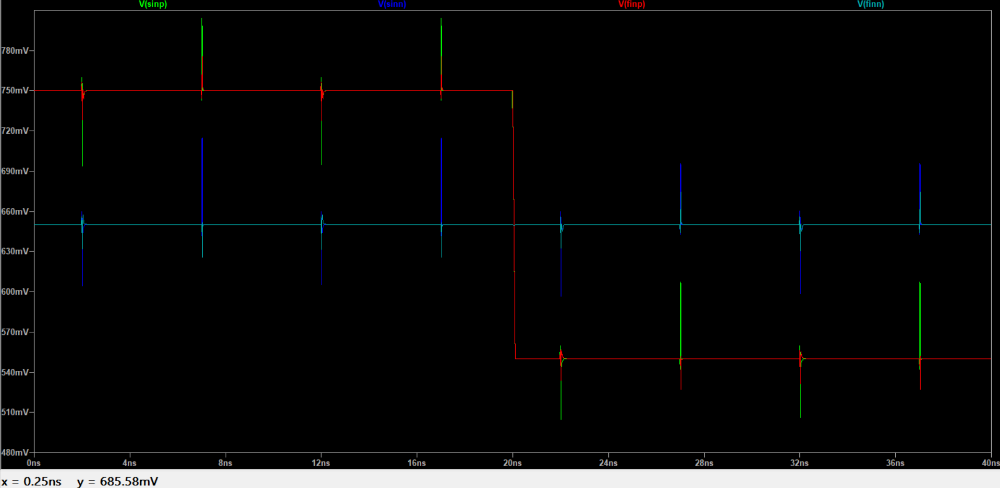
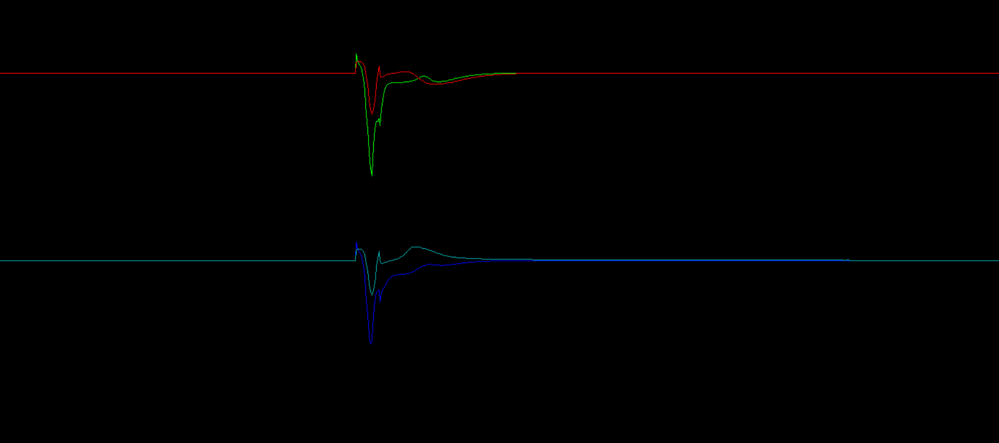

# Measurements and waveforms

## Figure 4 recreation

This is the initial **1.8 V teaching-model** waveform. At about 12 ns, Vin+ is above the 0.8 V reference and Out− falls. CLK falls around 17 ns and both outputs precharge high. The input changes near 20 ns; at the next rising edge near 22 ns, Out+ falls instead.

In the subsequent 65 nm test (1.1 V), both circuits and both simulators gave the expected rail-level decisions:

| Time | Vin+ | Clock phase | Out+ | Out− |
|---:|---:|---|---|---|
| 16 ns | 0.75 V | Evaluate | High | Low |
| 19 ns | 0.75 V | Reset | High | High |
| 26 ns | 0.55 V | Evaluate | Low | High |
| 29 ns | 0.55 V | Reset | High | High |

## Matched 65 nm results

Both latches use the same nominal BSIM4 card, 1.1 V supply, 27 °C, 100 MHz clock with 20 ps edges, and 5 fF per output. Vin− and the Figure 4 references are 0.65 V in the functional and delay checks. The table compares Figure 4 with Razavi’s 11-transistor reference within each simulator.

| Measurement | HSPICE Fig. 4 | HSPICE Razavi | LTspice Fig. 4 | LTspice Razavi |
|---|---:|---:|---:|---:|
| Comparison delay (ps) | 38.71 | 37.43 | 38.72 | 37.44 |
| Reset delay (ps) | 15.39 | 11.14 | 15.40 | 11.16 |
| Mean delay (ps) | 27.05 | 24.28 | 27.06 | 24.30 |
| Fast ramp VDD power (µW) | 1.9410 | 1.9152 | 1.9409 | 1.9144 |
| Fast ramp PDP (fJ) | 0.05250 | 0.04651 | 0.05252 | 0.04652 |
| Vin+ kickback peak (mV) | 22.31 | 54.87 | 22.13 | 54.95 |
| Vin− kickback peak (mV) | 22.31 | 54.87 | 22.13 | 54.95 |
| Slow ramp output overshoot (mV) | 45.19 | 73.45 | — | — |
| Nominal threshold bracket (mV) | −0.5 to +0.5 | −0.5 to +0.5 | — | — |

A dash means no numerical reading is reported here. Use decks 02 through 07 in the comparison folders to locate the matching measurement definitions. Delay uses the 0.55 V clock and output crossings; mean delay averages comparison and reset. Ramp supply power excludes the clock and input sources and is averaged over 10–70 ns of the fast ramp. Here PDP multiplies that power by mean delay from the separate delay run; it is not energy per clock cycle. The nominal threshold is a decision bracket, not a statistical mismatch measurement.

## Slow ramp and decision reversal

From [`03_ramp_overshoot.cir`](../comparison/ltspice/03_ramp_overshoot.cir). The input crosses 0.65 V near 1.48 µs and 3.52 µs; the decision reverses on the following evaluations. The dense bands are repeated precharge/evaluate cycles across the 5 µs display. This is the achieved counterpart of Figure 7 in the Bandla and Pal paper, which has its own process and supply. Output overshoot is the largest measured output peak above 1.1 V.

## Kickback overlay and interpretation

**Trace key:** Figure 4 Vin+ is `V(finp)` (red) and Vin− is `V(finn)` (cyan). Razavi Vin+ is `V(sinp)` (green) and Vin− is `V(sinn)` (blue). The broad Vin+ step at 20 ns is the applied stimulus; kickback appears as the short spikes around clock edges.

The upper pair is Vin+; the lower pair is Vin−. The Razavi trace dips farther from its pre-edge baseline in each pair. This crop omits the axes, so use the overview for context and the measurement table for the exact values. These screenshots plot absolute pin voltages.

To reproduce a **pin-minus-driver** overlay, run [`05_kickback_plus.cir`](../comparison/ltspice/05_kickback_plus.cir), plot `V(finp,vinp)` (Figure 4) and `V(sinp,vinp)` (Razavi) on the same axes, and zoom to **11.98–12.20 ns**.

Input kickback is the gate-side input voltage disturbance relative to the driver, measured with 1 kΩ in series. The peak metric uses the baseline-subtracted maximum absolute deviation in the tested evaluation windows. In the 12 ns evaluation window the LTspice log reports 54.95 mV for Razavi versus 22.13 mV for Figure 4 on Vin+, a reduction of about 60%.

The diagram and bars show setup and measured **peak magnitudes**, not a transient trace. Lower kickback could help preserve the small signal on a sensitive memory bitline. We did not test an SRAM cell or measure read margin. The conventional circuit’s advantage in this setup is a faster reset and lower ramp-test PDP.
